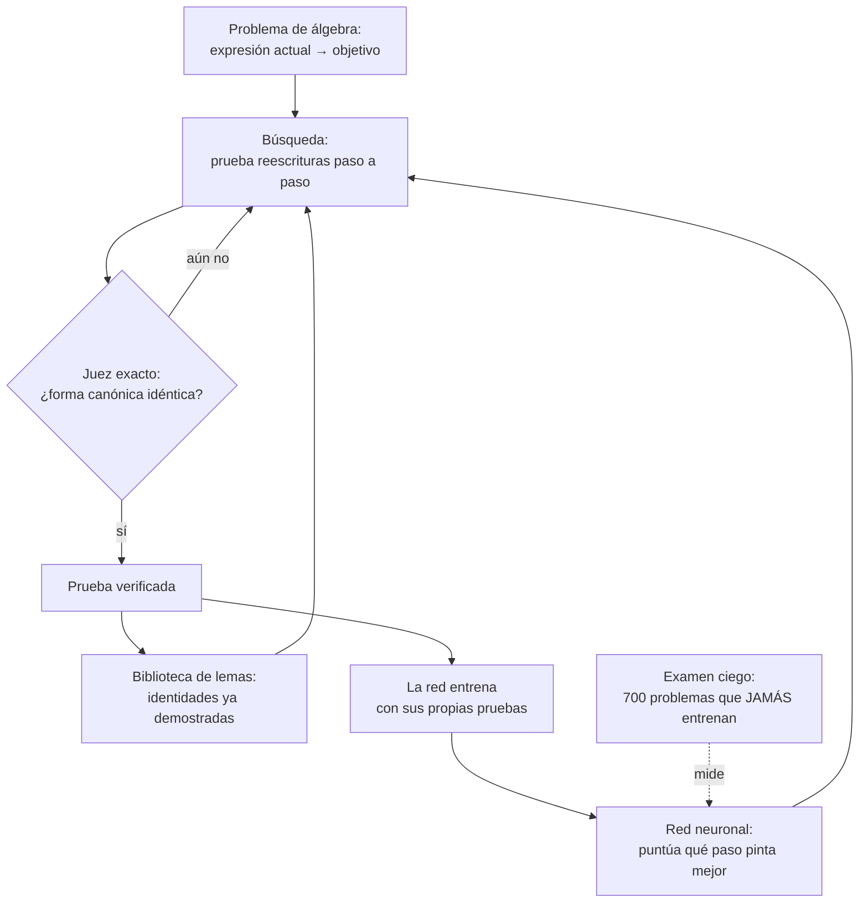

# Motor genérico de autojuego estilo AlphaZero

Motor genérico de autojuego estilo AlphaZero (MCTS + red neuronal + juez
exacto) que aprende solo: matemáticas, juegos y puzles.

> Visión (dirección del proyecto, no un resultado medido): "La meta es
> un «superaprendiz» que descubra cosas «tan profundas que no podemos
> expresarlas con las palabras que tenemos hoy»." - David Silver, FT.

## Cómo funciona



En 5 pasos:

1. **Se plantea un problema**: el motor recibe una expresión algebraica
   y un objetivo equivalente (más simple).
2. **La red aconseja**: para cada paso legal (regla algebraica o lema
   guardado) dice cuál tiene mejor pinta; la búsqueda prueba esos
   primero. Sin red, la búsqueda es ciega y mucho más lenta.
3. **El juez exacto decide**: nada de "parece correcto". Las dos
   expresiones se canonizan como polinomios y deben ser IDÉNTICAS.
   No hay trampas ni autoengaño.
4. **Aprende de sí mismo**: cada prueba verificada se convierte en
   ejemplos de entrenamiento, y las identidades útiles se guardan como
   lemas reutilizables. El núcleo crece solo, pero despacio y con
   medida: no crece ilimitadamente.
5. **Se examina en ciego**: 700 problemas (semilla fija 12345,
   excluidos del entrenamiento). Solo cuentan los números de ese
   examen; lo no medido no se afirma.

## Medido (conjunto ciego de 700 problemas, 12 oct)

| Resultado | Cifra | Estado |
|-----------|-------|--------|
| Curva de automejora, 3 ciclos (cap 1000) | 330 → 382 → 450/700 | ✅ |
| Aportación de la red (ablación misma semilla) | +150/700 sobre prior uniforme | ✅ |
| Lemas crudos como acciones (ablación replicada) | duplican branching: 450 con vs 526 sin biblioteca | ⚠️ poda en experimento (E9) |
| Juez exacto en Rust (230 vectores) | 0 discrepancias; canonización 4,2× Go; BFS empate 1,06× | ✅ |
| Micro-bench bucle MCTS | Rust 1,96× Go, C 1,88× (no predice al juez) | ✅ |
| E2 entrenamiento online | −23,3/700 (3 semillas) | ❌ descartado |
| E4 replay priorizado | 0,0/700 (6 semillas, ruido) | ❌ descartado |
| E8 transferencia k2-k5→k6-k8 | +2,7/700 (ruido) | ❌ descartado |
| Ejecutable Windows v0.1.1 (datos embebidos) | probado en Windows real: 136 reglas OK, BFS idéntico a Linux | ✅ |
| Tres en raya (Python, 6000 partidas) | 0 derrotas en 100 vs minimax; sin entrenar pierde 30/50 | ✅ |

Regla del proyecto: solo se incorpora lo que MEJORA con cifras en el
ciego; los fracasos se reportan igual que los éxitos.
Detalle: `mathzero/RESULTADOS_MEJORAS.md` y `mathzero/ROADMAP.md`.

## Componentes

1. **Núcleo Go (`mathzero/go/`)**: interfaz `Game` genérica + MCTS
   (PUCT). Dos juegos sobre el mismo motor: tres en raya y MathRing.
2. **MathRing (`mathzero/go/mathring.go`)**: demostración de
   identidades algebraicas con juez exacto (forma canónica de
   polinomio). La red guía la búsqueda y aprende por expert iteration
   con currículo de niveles k2-k8.
3. **Biblioteca de lemas (`mathzero/go/lemas.go`)**: caminos ya
   demostrados, reutilizables como reescrituras de un solo paso.
4. **Ciclo de automejora (`mathzero/go/ciclo.go`)**: autojuego →
   entrenamiento → verificación con juez exacto → biblioteca
   persistente → currículo automático → métrica ciega por ciclo.
5. **A/B de experimentos (`mathzero/go/exp.go`)**: cada idea de la
   literatura se mide contra su baseline con la misma semilla y el
   mismo ciego antes de adoptarse.
6. **Prototipo Python (raíz)**: AlphaZero completo del tres en raya en
   NumPy puro (red, backprop, MCTS y bucle de autojuego legibles),
   medido contra minimax.
7. **Demo web (`docs/`)**: el motor compilado a WebAssembly, público en
   https://fivetechsoft.github.io/alphazero/

## Pasos para ejecutar

1. Tres en raya (Python): `pip install -r requirements.txt` y luego
   `python train.py --games 1500 --sims 40` (guarda `model.npz`),
   `python evaluate.py --model model.npz`, `python play.py`.
2. Autojuego del tres en raya: `python selfplay.py --games 200 --sims 50`.
3. Motor Go: `cd mathzero/go && go build -o mathzero . && ./mathzero`
   (bench MCTS + chequeo del juez exacto + baseline BFS de MathRing;
   funciona sin ficheros al lado, todo va embebido). `./mathzero help`
   lista todos los subcomandos.
4. Aprendizaje de MathRing: `./mathzero learn`
   (12 rondas con currículo; guarda `model_math.json`).
5. Ciclo de automejora: `./mathzero cycle 3 60 1000`.
6. A/B de un experimento: `./mathzero ab e4 1 -json`
   (semilla 1, deja `resultados_ab_e4_seed1.json`).
7. Windows: descargar `mathzero.exe` de la Release v0.1.1 y seguir
   `GUIA_WINDOWS.txt` (ejecutar sin argumentos = prueba rápida).

## Pruebas

```bash
python -m unittest discover -s tests -v   # prototipo Python (rápido)
cd mathzero/go && go test ./...            # motor Go, juez y vectores
```

CI ejecuta además `gofmt`, `go vet`, los builds CLI/WASM, el juez Rust
contra los 230 vectores y los benchmarks C/Rust.

## Hoja de ruta

`mathzero/ROADMAP.md` define hitos con criterio "verificado" medible
cada uno. `mathzero/DISENO_AUTOMEJORA.md` describe el bucle de
crecimiento y sus límites.
